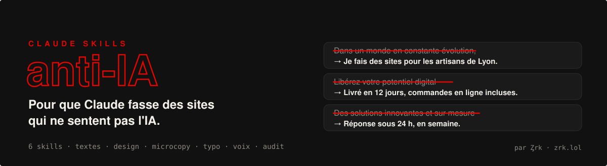

<div align="center">


</div>

Quand tu demandes un site à une IA, tu obtiens souvent la même chose : un dégradé violet, « Libérez votre potentiel », trois cartes avec une fusée, un éclair et un bouclier. Les visiteurs le repèrent tout de suite, et ça ne donne pas confiance.

Ces 6 skills apprennent à Claude à faire autrement. Ils se déclenchent tout seuls quand il écrit des textes ou code une page.

## 📦 Les skills

| Skill | Ce qu'il fait |
|---|---|
| ✍️ [`textes-humains`](skills/textes-humains/SKILL.md) | Écrit des textes concrets, avec des faits, et une liste de mots et tournures à bannir en français et en anglais. |
| 🎨 [`design-pas-ia`](skills/design-pas-ia/SKILL.md) | Évite les clichés visuels (dégradés, glassmorphism, cartes à icônes) et part de la marque. |
| 🔘 [`microcopy`](skills/microcopy/SKILL.md) | Boutons, formulaires, erreurs, confirmations, 404 : des libellés qui disent ce qui se passe. |
| 🇫🇷 [`typo-francaise`](skills/typo-francaise/SKILL.md) | Espaces insécables, « guillemets », majuscules accentuées, nombres et dates à la française. |
| 🗣️ [`voix-de-marque`](skills/voix-de-marque/SKILL.md) | Analyse tes vrais messages et écrit un guide `VOIX.md` pour que les textes sonnent comme toi. |
| 🔍 [`audit-site-ia`](skills/audit-site-ia/SKILL.md) | Note ton site sur 30 et liste les 5 corrections qui changent le plus. |

## 🚀 Installation

### Option 1 : en plugin Claude Code (recommandé)

Dans Claude Code, tape :

```
/plugin marketplace add zrk-lol/claude-skills-anti-ia
/plugin install anti-ia@zrk
```

### Option 2 : à la main

Copie les dossiers de `skills/` dans :

- `~/.claude/skills/` pour les avoir dans tous tes projets ;
- ou `.claude/skills/` à la racine d'un projet pour ce projet seulement.

```
git clone https://github.com/zrk-lol/claude-skills-anti-ia
cp -r claude-skills-anti-ia/skills/* ~/.claude/skills/
```

### Option 3 : sur claude.ai

Zippe un dossier de skill (par exemple `skills/textes-humains/`) et importe-le dans **Paramètres → Capacités → Skills**.

## 💬 Exemples de demandes

- « Refais la page d'accueil de mon site, elle fait trop IA. »
- « Audite le site dans ce dossier et dis-moi ce qui fait généré. »
- « Voici 10 messages que j'ai envoyés à des clients, crée le guide de voix de ma marque. »
- « Écris les messages d'erreur du formulaire de contact. »

## ✍️ Avant / après

> **Avant :** Dans un monde numérique en constante évolution, notre agence vous accompagne avec passion pour propulser votre présence en ligne grâce à des solutions innovantes et sur mesure.
>
> **Après :** Je fais des sites pour les artisans de Lyon. Le dernier, pour une boulangerie de la Croix-Rousse, a été mis en ligne en 12 jours. Elle prend maintenant ses commandes de gâteaux par le site au lieu du téléphone.

## 🤝 Contribuer

Tu as repéré un nouveau tic d'IA ? Ouvre une issue ou une PR avec un exemple réel. On en parle aussi sur le [Discord](https://discord.gg/4qRhB4c5me).

<div align="center">

<br/>

Fait par **[Ȥrk](https://github.com/zrk-lol)** · [zrk.lol](https://zrk.lol) · [Discord](https://discord.gg/4qRhB4c5me)

Tu veux un site qui ne sent pas l'IA, fait par un humain ? [Parlons-en](https://zrk.lol).

</div>
